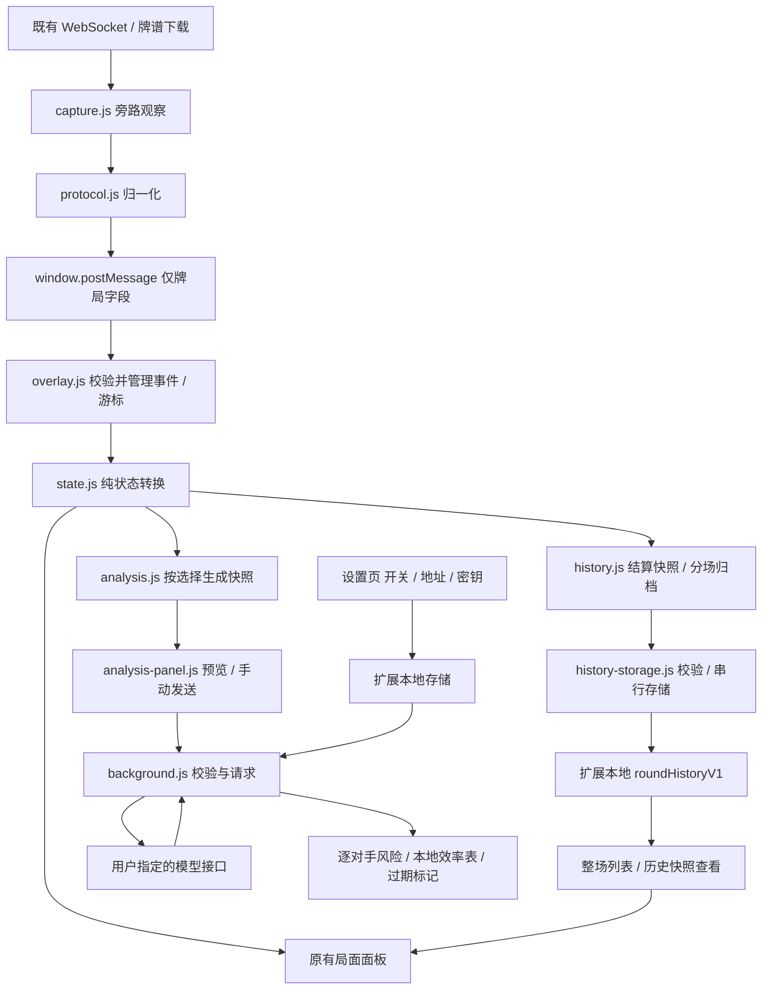

# 项目架构

这是无构建步骤、无第三方运行依赖的 Manifest V3 扩展。`extension/` 可直接作为解压缩扩展加载。采集、状态、展示和模型网络访问各自独立；新增模型功能复用现有状态，不重新读取或操作游戏。

## 目录与职责

| 文件 / 目录 | 职责 | 运行位置 |
| --- | --- | --- |
| `extension/manifest.json` | 加载顺序、执行世界、可选主机授权、后台与设置入口 | 浏览器 |
| `extension/protocol.js` | 最小 Protobuf reader、Liqi 帧与牌局消息归一化 | MAIN / Node 测试 |
| `extension/capture.js` | WebSocket、既有牌谱下载的旁路观察，过滤非牌局数据 | 游戏 MAIN 世界 |
| `extension/state.js` | 纯状态转换、座风、手牌布局、宝牌和立直推导 | ISOLATED / Node 测试 |
| `extension/history.js` | 整场与各局记录、快照整理 | ISOLATED / 后台 |
| `extension/history-storage.js` | 整场记录的本地存储消息处理，与模型配置分键保存 | 扩展 Service Worker |
| `extension/overlay.js` | 桥接消息校验、实时与牌谱游标、导出、主体面板和刷新节流 | ISOLATED 世界 |
| `extension/mahjong-analysis.js` | 向听、形状进张、已见牌计数和逐对手防守特征 | ISOLATED / 后台 / Node 测试 |
| `extension/analysis.js` | 授权快照、逐任务合同与提示词、JSON Schema、严格结果校验、接口验证 | ISOLATED / 后台 / 设置 / Node 测试 |
| `extension/analysis-panel.js` | 数据范围与任务选择、发送预览、结构化牌面建议、本地效率表和过期提示 | ISOLATED 世界 |
| `extension/background.js` | 身份校验、读取配置、验证授权、添加密钥、调用模型、取消与超时 | 扩展 Service Worker |
| `extension/options.html/js/css` | 开关、接口、模型、密钥；主机权限申请、保存与清除 | 扩展设置页 |
| `extension/tiles/` | 本地牌面资源 | 扩展静态资源 |
| `tests/` | Node 协议、采集、状态、分析测试与离线浏览器预览 | 本地 |
| `research/` | 调研记录与被 Git 忽略的本地验证证据 | 开发使用 |
| `dist/` | 可解压安装的版本包 | 分发使用 |

## 数据流

MAIN 中的采集器仅观察已有通信，不主动获取牌谱，不调用游戏出牌接口。桥接数据不作为可信来源；模型消息不复用页面的 `postMessage` 通道。

状态机独立于 UI。实时数据和牌谱数据分别维护；牌谱只分析插件当前游标的状态，不分析未来记录。`overlay.js` 每次渲染将当前状态和游标上下文交给分析面板；分析面板保持自己的发送选择、请求状态和结果，并通过快照指纹识别旧结果。

## 历史记录边界

`history.js` 逐字段整理结算快照，实时与牌谱分场保存，按局数和本场去重；下一局开局可补齐上一局未知点数。历史快照独立于当前状态，查看记录不会移动牌谱游标或停止实时采集。当前未使用稳定游戏ID，刷新或断线后可能将同一场分段。

`history:load` / `history:save` 由后台的 `history-storage.js` 处理，限制同扩展、指定游戏origin与顶层frame；通过队列串行读改写，使用独立的 `roundHistoryV1` 键，不读取或返回模型配置。保留最近20场、每场最多100局，并按约4MiB总量淘汰最旧场次。离线预览仅使用独立localStorage键，不与真实扩展共享记录。

## 模型模块边界

内部授权快照保持 `mj-analysis-v1`，后台 `cleanSnapshot()` 再次逐字段清洗后，`prepare()` 生成外发 `mj-analysis-v2`。任务为 `danger`、`efficiency`、`combined`，兼容旧 `discard` / `both`。防守使用有序牌河及 nullable 手摸切；效率只使用自家手牌、副露和已授权已见牌统计；综合任务通过一次模型请求组合两模块输入和提示词。

`MJMahjongAnalysis.analyze()` 仅接收清洗后的快照。`localAnalysis` 按任务挑选防守或效率结果；后台忽略页面消息自带的本地计算字段，重新计算。算法和合同采用有界缓存，预览通过 `model:prepare` 在后台异步计算，避免界面刷新阻塞游戏线程。后台请求和预览共用 `prepare()` 的真实数据。普通型、七对子、国士向听及有效牌由本地计算，未见枚数为上界，模型只作解释。

输出经固定 JSON Schema 和本地严格解析校验，兼容 JSON 代码围栏，无需服务商支持 `response_format`。检查任务、合法候选、逐对手风险、现物证据及无内容结果；13 张、立直摸牌未知、手牌非法或已结算时禁止具体弃牌建议。未知手摸切保留 `null`，协议已确认的默认 `false` 仍为手切。界面转义文本，仅加载本地 SVG 牌面；任务、取消或配置变更使在途响应失效，防止旧结果回填。

- **数据合同**：`mj-analysis-v1` 包含来源、完整性、阶段、自家座位、最近动作序号和有限的采集警告。可选的 `game` 不含手牌和牌河；`rivers` 仅含所选座位的弃牌及摸切、立直、已鸣标记；`selfHand` 仅含已选自家的手牌。显式逐字段拷贝，避免扩展局面对象时顺带外发账号或对手暗牌。
- **凭据**：`modelConfig` 由设置页保存到 `chrome.storage.local`，后台将访问级别限制为 `TRUSTED_CONTEXTS`。内容脚本通过 `model:status` 仅取得开关和模型名称。设置回到游戏时刷新状态，也可手动刷新；即使面板状态过时，后台仍重新检查开关与授权。
- **授权**：manifest 只声明可选主机范围，设置页在用户点击保存时申请配置的主机。允许 HTTPS 和 HTTP loopback；拒绝 URL 用户信息、查询和片段。目标端口保留在实际请求地址中，授权模式遵循浏览器按主机匹配的规则。
- **消息**：`model:settings` 打开设置，`model:status` 查询状态，`model:analyze` 发送当前快照与任务，`model:cancel` 取消当前标签页的请求。后台只接受同扩展、指定游戏 URL、顶层 frame 的调用，不接受任意请求地址或密钥参数。
- **网络**：单标签页最多一个请求；25秒超时；拒绝重定向、不携带浏览器 cookies；请求快照上限60000字符，响应上限1MiB，展示上限16000字符。关闭、修改或清除设置会取消进行中的请求。
- **展示**：模型文本进行 HTML 转义，不执行模型输出的 HTML、脚本或链接。模型只作建议，不参与状态更新或出牌。

## 变更与验证

协议变更修改 `protocol.js` 并补人工协议帧；采集兼容性修改 `capture.js`；局面规则和推导修改 `state.js`。新增发送字段应先修改 `analysis.js` 的显式合同和测试；新模型协议应在后台适配，不将密钥或网络调用移入页面脚本。

运行 `npm test`。分析测试通过 VM 中的模拟 Chrome API 和模拟 HTTP 响应覆盖开关、授权、身份、请求、错误与取消，不连接真实模型。`tests/preview.html` 用于离线界面验证，不代表真实协议采集或模型正确率。版本验证记录见 `VALIDATION.md`。
