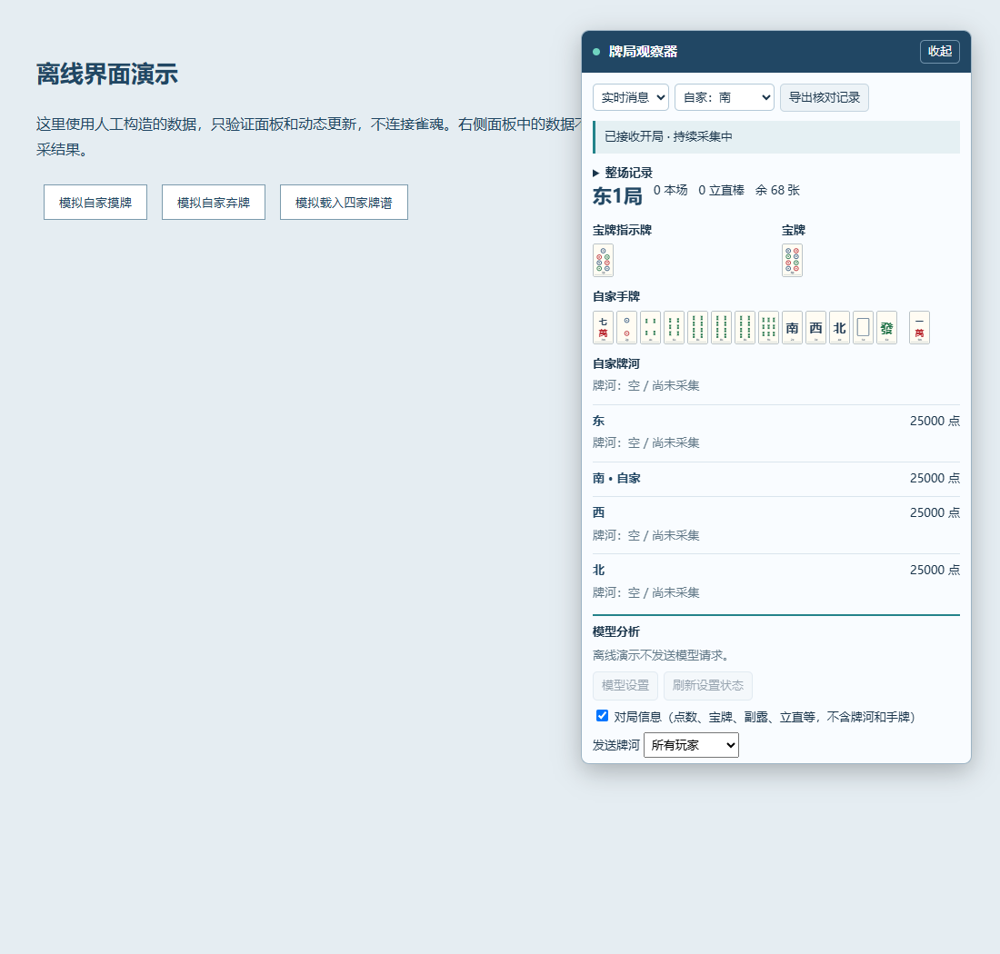

# Majsoul Agent · Mahjong analysis and review

[简体中文](README.md) | **English** | [日本語](README.ja.md)

A browser extension for the Mahjong Soul web client. Inspect the table in an in-game panel, keep local match results, and manually send selected game data to an LLM service of your choice. Built with Manifest V3, with no third-party runtime dependencies or telemetry. LLM analysis is disabled by default.

These language links switch the documentation only. The extension UI is currently in Simplified Chinese. English and Japanese documentation does not imply support for other regional game servers.

This document describes **0.4.0**. It integrates the 0.3.0 analysis modules with a separate Agent layer, a harness, and a collector-only distribution. Earlier Edge and offline checks do not validate the new installation profiles; those profiles and other Chromium browsers still need browser testing. Full live protocol coverage for the current Unity client, reconnection recovery, and the quality of real model advice remain unverified. No live recognition accuracy or playing strength is claimed.



## Features

- **In-game panel:** your hand and drawn tile, all players’ discards and melds, scores, round information, and opponents’ riichi alerts. Drag the title bar to move the panel; its position persists after refresh.
- **Dora display:** indicators and corresponding dora shown side by side, including honor-tile cycles, red fives, and three-player manzu rules. Hidden ura-dora is not inferred.
- **Match history:** browse wins, draws, final hand scores, and score changes by match, hand, and honba. Collection continues while viewing an older hand.
- **Replay inspection:** parse an already downloaded replay and inspect it with an independent event cursor, including all four hands when present in the replay.
- **Bring your own model:** configure an OpenAI Chat Completions-compatible endpoint. Select table information, all or selected discard pools, and optionally your own hand; preview the payload and manually request danger or discard advice.

Local history retains up to 20 matches and 100 hands per match, evicting the oldest matches at roughly 4 MiB total. Records are end-of-hand snapshots, not event-by-event replays. Refreshes or disconnects may split a match into separate records. Tiles are sorted by suit; manually rearranging tiles in the game is not mirrored.

## Installation

| Package | Capabilities |
| --- | --- |
| `majsoul-agent-0.4.0.zip` | Collector, panel, match history, Agent, model settings, and harness traces |
| `majsoul-collector-0.4.0.zip` | Collection, display, history, and export only; no model code, settings page, or model host permissions |

Enable only one profile on a game page. The collector works independently and can export records for offline review. The profiles have separate local storage and do not migrate data automatically. The source `extension/` directory is the full edition; `npm run build` generates both loadable directories.

The independent `extension/profiles/agent.json` and `collector.json` profiles select `apps/agent-app.js` and `apps/collector-app.js` as composition entries. Building follows each profile's dependency closure to produce `dist/majsoul-agent-0.4.0/` and `dist/majsoul-collector-0.4.0/`; load either directory directly. The collector package contains only the files needed for collection, display, history, and export.

1. Download and extract the source ZIP, or clone the repository. For a source checkout, use the **`extension/` directory**.
2. Open `edge://extensions` in Edge or `chrome://extensions` in Chrome, and enable Developer mode.
3. Choose **Load unpacked** and select that directory. For the dedicated extension ZIP, select the extracted directory that directly contains `manifest.json`.
4. Refresh the Mahjong Soul page so the collector loads before the game connection is established, then enter a game or reopen a replay.
5. The `Majsoul Agent` or `雀魂牌局获取器` panel appears on the right. Drag its title bar or click `收起` to collapse it. Recent events and collection status are collapsed by default.

After updating, reload the extension in the browser’s extension manager, then refresh the game. Refreshing resets your replay position. Existing connections and previously downloaded replay data cannot be read retroactively.

Only **`https://game.maj-soul.com/*`** is currently matched. Other regional domains, Firefox, Safari, and the Steam desktop client are not supported. Architectural compatibility with Chrome or Brave is not a substitute for testing.

## Agent and harness

The collector controller owns table state, replay cursors, history, and exports; the UI interacts through views and commands. A separate adapter maps the user's selection to the standard `mj-analysis-v1` DTO. The Agent depends on the pure data contract without reading collector state layouts, so another collector can supply the same DTO. The analysis panel receives only a snapshot function and display inputs. Composition entries connect these components; see [decoupling design](docs/DECOUPLING.md) and [architecture](ARCHITECTURE.md) (Chinese).

The Agent maps danger, tile-efficiency, and combined tasks to bounded workflows. The harness executes registered tools, limits steps and runtime, propagates cancellation, and records tool metadata without game payloads or credentials. The full edition runs snapshot validation → local analysis and prompt preparation → model explanation → result validation. Successful results include a collapsible `Agent 运行记录` trace. This first version uses a fixed plan and at most one model request per run; the model does not select tools autonomously or retry indefinitely.

Review a collector `mj-observer-v1` JSON export locally with Node.js 22+:

```sh
npm run review -- observation.json --seat 0 --hand --cursor 12
npm run eval
```

`--seat` is a protocol seat ID from 0 to 3. `--hand` explicitly includes your own hand, which is excluded by default. For replays, `--cursor` applies only the first N events and never uses future states. Omit it for live exports, which use the exported snapshot. The CLI performs local analysis without a model request. The built-in evaluation contains three synthetic shanten regressions; it does not measure model quality or playing strength. See [Agent and harness](docs/AGENT.md) (Chinese).

## LLM setup

1. Open `模型分析 → 模型设置`, enable analysis, and enter the full endpoint URL, model ID, and API key.
2. Example: `https://api.openai.com/v1/chat/completions`. Compatible local services can use `http://localhost:PORT/v1/chat/completions` or `http://127.0.0.1:PORT/v1/chat/completions`; the key may be empty when authentication is unnecessary.
3. Save and grant host access for the configured service, then select the data to send. Your hand is excluded by default; confirm your seat before including it.
4. Select dangerous-tile advice, discard advice, or both. Expand `预览发送数据` to inspect the payload, then start analysis manually.

Each request uses a snapshot taken when clicked. Results are marked stale when the table or selected data changes. Viewing and analysis remain available with incomplete collection; details appear in the collapsed collection status and exported data.

The three analysis tasks use separate data contracts and modular prompts. Danger analysis retains selected players’ ordered discards, discard-from-hand/draw distinctions, riichi, and melds. Tile-efficiency analysis sends only your hand, melds, rules, and authorized visible-tile counts, excluding full discard histories. Combined offense/defense analysis uses both modules in one request.

The extension computes shape-based shanten and improving tiles locally for standard hands, seven pairs, and thirteen orphans. The model explains these results and weighs offense against defense. The table’s unseen-tile counts are upper bounds, not counts of tiles remaining in the wall; zero means all copies have been seen. For high-shanten hands, the calculation compares shape improvements rather than exhaustively searching every future draw/discard sequence. A 13-tile hand shows only its current shanten and improving tiles. After riichi, only the confirmed newly drawn tile can be recommended for discard; if it is unknown, no specific discard is suggested. Completed hands are analyzed only as mathematical reviews.

Model output must follow a JSON Schema; JSON code fences are accepted. The extension rejects discard suggestions outside your hand or unsupported by locally legal candidates. Claims that a tile is genbutsu require local evidence from the relevant opponent’s discards. Shanten and improving-tile counts come from local calculations; model-provided numeric fields outside the contract are rejected. The preview shows the actual outgoing data, and local calculations run in the background component.

The endpoint must support non-streaming `POST /chat/completions` with string content in `choices[0].message.content`; provider-side `response_format` support is not required. Native Anthropic, Gemini, and Responses API formats are not directly supported. Requests time out after 25 seconds, with one concurrent request per tab.

Advice may be wrong or late, calls may incur charges, and the configured provider processes the input. Real provider compatibility and advice quality still need validation. The API key stays in extension-local storage, is read only by the background component, and is excluded from game exports and the page bridge. See [SECURITY.md](SECURITY.md) for details.

## History and replays

Hand results show tsumo, ron, exhaustive draws, or abortive draws, along with scores and net changes from the start of the hand, including riichi payments. Missing final scores remain unknown and may be completed when the next hand begins.

Expand `整场记录`, select a match, and click `查看` for a hand to inspect its result snapshot. Click `返回当前牌局` to return to the current table. Uncollected earlier hands cannot be recovered automatically. Loading a complete replay can archive its hands; repeated loads of the same replay are deduplicated.

The replay cursor is **independent of game playback**. Use the previous/next event controls to align it manually; it does not follow playback automatically. Live collection uses only your own information and public table data already delivered to the client. Seeing four hands in a replay does not mean opponents’ concealed tiles are available during a live game.

## Limitations

- The current client protocol still needs full-match live validation. Special rules, protocol changes, and reconstruction after reconnecting are not fully covered.
- State is derived from received events. Missing frames, joining mid-hand, or late seat detection may affect the hand. Completeness markers are retained without persistent warnings.
- Seat winds rotate with the dealer and are not fixed screen positions. Your seat can be detected automatically or selected manually.
- The extension does not play automatically, alter game messages, proactively download replays, or infer the tile wall or opponents’ concealed hands.
- Read-only operation does not imply approval from the game operator. Check the platform rules. This is an unofficial project with no affiliation with the game publisher.

## Development and validation

Use Node.js 22 or newer. No runtime dependencies need to be installed:

```sh
npm run check
npm test
npm run build
```

`check` validates static dependency boundaries, browser-free core modules, profile resources, and loading order. `build` copies each profile's dependency closure without rewriting shared UI source. These checks do not establish live protocol compatibility or model quality.

Serve `tests/preview.html` with a local static server for the offline demo. For example, with Python installed:

```sh
python -m http.server 8126 --bind 127.0.0.1
```

Open `http://127.0.0.1:8126/tests/preview.html`. Tests and demos use synthetic protocol frames, mocked browser APIs, and simulated model responses. They do not connect to an account or a real model and do not establish live capture accuracy or advice quality. See [VALIDATION.md](VALIDATION.md).

| Document | Contents |
| --- | --- |
| [ARCHITECTURE.md](ARCHITECTURE.md) | Module responsibilities, events, and model data flow |
| [CONTRIBUTING.md](CONTRIBUTING.md) | Local development, reproduction data, and PR requirements |
| [SECURITY.md](SECURITY.md) | Permissions, credentials, data handling, and vulnerability reports |
| [CHANGELOG.md](CHANGELOG.md) | Version history |
| [docs/PUBLISHING.md](docs/PUBLISHING.md) | Clean snapshot packaging and publication steps |

The supporting documents above are currently in Simplified Chinese. When updating a README, keep the feature descriptions and limitations consistent across all three languages.

## License and references

Source code and 37 original SVG tile faces are available under the [MIT License](LICENSE). Tile faces are generated by this repository’s script; no game screenshots or external fonts are bundled.

[mj_helper](https://github.com/tzp1021/mj_helper) informed the collection/state-machine layering and open-source repository organization, alongside other protocol research. This project focuses on an in-browser panel, result history, and user-selected models. It does not bundle mj_helper’s Python decision engine or claim equivalent playing strength. See [THIRD_PARTY_NOTICES.md](THIRD_PARTY_NOTICES.md) for references and the handling of legacy assets.
