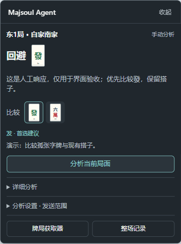

# Majsoul AI Analysis & Review Agent

雀魂 AI 牌局分析与复盘助手

**简体中文** | [English](README.en.md) | [日本語](README.ja.md)

面向雀魂网页版的浏览器扩展：在游戏内查看牌局、保存整场结算记录，并手动选择数据交给自己的大模型分析。采用 Manifest V3，无第三方运行依赖、无遥测，模型分析默认关闭。

**模型由你选择，API 由你接入。** 自行填写接口地址、模型 ID 和 API Key，即可连接提供 **OpenAI Chat Completions 兼容接口**的云端模型、第三方网关或本地模型服务，不绑定单一模型厂商。请求直接发往你配置的服务，无需经过本项目的中转服务器。[查看接入方法](#接入大模型)

以上语言切换仅适用于项目介绍，扩展界面目前为简体中文；英文、日文介绍不代表已支持其他地区的游戏域名。

当前为 **0.4.0**。复用0.3.0的分析模块，加入独立Agent执行层、harness与仅获取器分发。两种安装组合已在独立Edge与Chrome环境中通过人工牌局模拟验收。当前Unity客户端的完整实时协议、断线恢复及真实模型建议质量仍待验证；项目不宣称实战识别正确率或牌力水平。

项目统一维护于[oreki-L/majsoul-ai-analysis-and-review-agent](https://github.com/oreki-L/majsoul-ai-analysis-and-review-agent)，保留经过敏感内容清理的完整原私有开发历史，详见[历史迁移说明](docs/HISTORY.md)。



## 功能

- **自接模型 API**：自定义 endpoint、模型 ID 和 API Key，使用兼容协议的不同模型服务；选择对局信息、全部或指定牌河、自家手牌，预览后手动发送，显示危险牌与出牌建议。
- **自由悬浮分析卡**：分析结果独立常驻，标题栏可拖动并记住位置；首选与候选牌可点选查看理由，手牌、本地效率表与运行记录收在“详细分析”中。获取器默认收起，按需打开牌河、宝牌与整场记录。
- **手牌提示**：首次手动校准后，将建议弃牌与高危牌标在当前实时手牌上，同种牌副本联动；正常提示不拦截出牌点击。局面变化立即清除旧标记，延迟结果不会标在新局面上。
- **宝牌换算**：指示牌与实际宝牌并列展示，包含字牌循环、赤五及三麻万子规则；不推测里宝牌。
- **整场记录**：按场次、局数和本场查看和牌／流局、结算点数与本局净变化；查看旧局期间继续采集。
- **牌谱复盘**：解析已下载牌谱，以独立事件游标查看局面；可以查看牌谱中已知的四家手牌。

本地历史最多保留最近20场、每场100局，并按约4MiB总量淘汰最旧场次。保存的是结算快照，不是逐事件回放；刷新或断线后同一场可能分段。手牌默认按花色排序，游戏内手动拖牌的次序不会同步。

## 安装

### 选择安装内容

| 安装包 | 提供的能力 |
| --- | --- |
| `majsoul-ai-analysis-and-review-agent-0.4.0.zip` | 获取器、局面面板、结算历史、Agent、模型设置与harness运行记录 |
| `majsoul-collector-0.4.0.zip` | 仅采集、展示、历史与导出；不含模型代码、设置页或模型主机权限 |

同一游戏页面只启用其中一个版本。获取器可以独立使用，导出记录再交给离线复盘工具；两种扩展的本地存储独立，不自动迁移。源码中的 `extension/` 为完整版；运行 `npm run build` 会生成两种可加载目录。

两版使用独立的`extension/profiles/agent.json`和`collector.json`，分别加载`apps/agent-app.js`与`apps/collector-app.js`组合入口。构建按依赖闭包生成`dist/majsoul-ai-analysis-and-review-agent-0.4.0/`和`dist/majsoul-collector-0.4.0/`，可直接加载其中一个目录；获取器包仅包含采集、展示、历史与导出所需文件。

1. 下载源码 ZIP 并解压，或克隆仓库。源码方式选择其中的 **`extension/` 文件夹**。
2. Edge 打开 `edge://extensions`；Chrome 打开 `chrome://extensions`，开启“开发者模式”。
3. 点击“加载已解压的扩展程序”，选择上述文件夹。若使用专用扩展安装 ZIP，选择解压后直接含 `manifest.json` 的文件夹。
4. 刷新雀魂网页，让采集器在游戏连接建立前加载，再进入牌局或重新打开牌谱。
5. 完整版右侧出现独立“Majsoul AI Analysis & Review Agent”分析卡，左侧“牌局”入口默认收起；仅获取器版显示左侧入口。两者均可拖动，独立记住位置。“最近事件”和“采集状态”默认折叠。

更新源码后，先在扩展管理页“重新加载”，再刷新游戏。刷新会离开当前回放位置，已有连接或已下载牌谱无法追溯读取。

目前仅匹配 `https://game.maj-soul.com/*`。Firefox、Safari、Steam 桌面端和其他地区域名尚未适配；Chrome、Brave 等浏览器的架构兼容性不等于已完成实际验证。

## Agent 与 harness

获取器的controller负责局面、游标、历史和导出，UI通过视图和命令与它交互。独立adapter把用户选择映射为`mj-analysis-v1`标准DTO，Agent直接依赖纯数据合同，不读取获取器state布局。其他采集器可提供相同DTO；分析面板只接收快照函数和展示信息。组合入口负责连接各组件，详见[解耦设计](docs/DECOUPLING.md)和[架构](ARCHITECTURE.md)。

Agent把危险牌、牌效率和综合攻守任务映射到有界工作流；harness执行已注册工具、限制步数与时间、传递取消信号并生成不含牌局内容或密钥的运行记录。完整版实际调用路径为“快照校验 → 本地分析与提示词准备 → 模型解释 → 结果校验”，成功后可展开“Agent运行记录”。当前采用固定计划，每次最多一次模型请求，不具备模型自主选工具或无限重试能力。

获取器导出的 `mj-observer-v1` JSON可在Node.js 22+中进行本地复盘：

```sh
npm run review -- observation.json --seat 0 --hand --cursor 12
npm run eval
```

`--seat` 使用协议座位编号0至3；`--hand` 明确授权分析自家手牌，默认不使用手牌。`--cursor` 仅适用于牌谱，表示应用前N条事件，不会读取游标后的未来局面；实时导出省略该参数，使用导出时的快照。CLI只执行本地分析，不请求模型。内置评测是3个人工向听回归样例，不代表模型质量或实战牌力。详见 [Agent与harness](docs/AGENT.md)。

## 接入大模型

完整版支持自带模型 API，无需使用项目指定的服务或账号。LLM 分析与解释仍是主要用途；默认选择 `chat` 且分析关闭。`chat` 与可选 `mjai` 各保留一份配置，保存后一次仅使用选中的一种，不同时调用两者。

| 服务类型 | 接入方式 |
| --- | --- |
| 云端模型或第三方兼容网关 | 填写 HTTPS 的 Chat Completions 完整地址、模型 ID 和自己的 API Key |
| 本地模型服务 | 启用 Chat Completions 兼容接口，填写 localhost 或 127.0.0.1 地址及端口；无需鉴权时 Key 可留空 |
| 仅提供其他原生协议的服务 | 先通过提供 Chat Completions 兼容接口的网关转换，再配置网关地址 |

1. 在分析卡展开“分析设置 · 发送范围”，点击“模型设置”，开启分析，填写接口完整地址、模型 ID 及 API Key。
2. 接口示例：`https://api.openai.com/v1/chat/completions`。本机兼容服务支持 `http://localhost:端口/v1/chat/completions` 或 `http://127.0.0.1:端口/v1/chat/completions`，无需鉴权时密钥可留空。
3. 保存并授予所配置服务的主机权限，回到游戏选择发送范围。自家手牌默认不发送；需要发送时先确认自家座位。
4. 选择“危险牌”“牌效率”或“综合攻守”，展开“预览发送数据”核对，再手动点击分析。

每次请求使用点击时的快照；局面或发送范围变化后，旧结果会标记过期。允许在采集不完整时继续查看和分析，相关详情放在折叠的采集状态与导出数据中。

需要在游戏手牌上显示提示时，在牌桌中打开“分析设置 · 发送范围 → 校准手牌提示”，拖框覆盖13张主体、间隔及摸牌位，再确认。校准按单个可见游戏Canvas的比例保存；假定万、筒、索、字顺序以及副露后剩余手牌左对齐，不自动识别单牌坐标，也不跟踪手动拖牌顺序。更换布局或提示偏移时应重新校准。未知手牌、多Canvas或牌谱／历史模式不贴牌。当前只显示建议与定性风险，不将模型偏好或进张上界当成概率。

三种任务使用独立数据合同与模块化提示词。危险牌保留所选玩家的有序牌河、手切／摸切、立直和副露；牌效率仅发送自家手牌、副露、规则和授权已见牌统计，不发送完整牌河历史；综合攻守在一次请求中组合两模块。

普通型、七对子、国士的形状向听及进张由插件本地计算，模型解释结果并权衡攻守。表格的“未见枚数上界”不代表牌山剩余枚数；0 枚会标注“已见耗尽”。高向听采用形状进张比较，不穷举全部后续摸打路径。13 张手牌仅显示当前向听和进张；立直后仅能建议已确认的本次摸牌，未知时不建议具体弃牌；结算局面仅作数学复盘。

输出须符合 JSON Schema，兼容 JSON 代码围栏。插件拒绝手牌以外、未获本地合法候选支持的弃牌建议；“现物”须有对应对手的本地牌河证据。向听和进张数值使用本地结果，模型填入合同外数字字段会被拒绝。预览展示实际外发数据，本地计算在后台执行。

支持非流式 `POST /chat/completions` 与字符串 `choices[0].message.content`，无需服务商支持 `response_format`；不直接支持原生 Anthropic、Gemini 或 Responses API，可经兼容网关接入。接口须兼容请求与响应格式，模型仍须按上述 JSON Schema 输出。请求25秒超时，单标签页同时一个请求。

模型可能判断错误或回复不及时，调用可能收费，输入由所配置服务处理；真实服务商兼容性和建议质量尚待验证。API Key 保存在扩展本地存储，仅由后台读取，不进入牌局导出或游戏页面桥接。详情见 [SECURITY.md](SECURITY.md)。

## 可选 mjai 本地引擎

Mortal/mjai 仅是默认不启用的可选适配，需要自备模型、权重及推理依赖，不替代主要的 LLM 分析功能。完整版可连接手动启动的本机桥接服务；获取器保持独立且无第三方运行依赖，不包含引擎模块或权限。

```sh
npm run engine:serve -- --config runtime.json --port 17341
npm run engine:review -- observation.json --config runtime.json --seat 0 --hand --cursor 12
```

`runtime.json` 指定可信本机程序；程序以 JSONL 接收一行完整事件数组，返回一行动作。提供 Python `Bot.react` 包装器，但上游模块必须自行初始化并加载用户权重，不能假设任意 `bot.py` 可直接使用。运行命令不是沙箱，上游许可另行适用。设置页选择 `mjai`，填写本地 `/analyze` 地址及 Bearer Token；页面仅支持完整无副露四麻的合法弃牌、立直意向和跳过，自家14张开局记录明确拒绝。Q 值不作为放铳概率，不自动打牌，尚无真实权重验证。[接入步骤、配置与限制](docs/MJAI.md)

## 可选 NAGA 牌谱导出

完整版的“牌谱复盘 · NAGA”默认关闭。打开完整牌谱后启用，明确选择东风／半庄、各色一枚赤牌／无赤牌及四人喰断规则，再确认生成。转换在本地读取整份牌谱，不受当前游标限制；可选局、预览、复制或下载逐局 `Tenhou URL`，再打开 [NAGA 官方提交页](https://naga.dmv.nico/naga_report/order_form/)自行登录和提交。导出包含四家手牌并将玩家名替换为座位标签。

首版支持标准四麻的吃碰杠、立直、单家和牌与普通荒牌流局；多家和牌、包牌、流局满贯、途中流局、三麻、未知役种和资料缺失的局明确拒绝。完整规则与验证范围见 [NAGA 接入说明](docs/NAGA-INTEGRATION.md)。扩展不自动上传、扣费或读取报告，不接收账号凭据；官方费用与受理结果以官方页面为准。独立获取器不包含 NAGA 模块。

## 记录与复盘

结算时显示自摸／荣和／荒牌流局／途中流局，以及各家点数和相对开局的净变化，包含立直扣点。缺失的结算点数保持未知，收到下一局开局后可补齐。

展开“整场记录”，选择场次和某局的“查看”，可回看结算快照；点击“返回当前牌局”恢复当前画面。未采集到的旧局不能自动补回；完整牌谱载入后可按局归档，同一牌谱重复载入会去重。

牌谱游标**独立于游戏播放**，需用“上一事件／下一事件”手动对齐，不随游戏播放自动移动。实时对局只使用已下发的自家信息与公开牌局数据，牌谱四家手牌不代表能读取实时对手暗牌。

## 已知边界

- 当前客户端协议仍需真实整场验证，特殊规则、跨版本封装和断线快照重建未完整适配。
- 状态由收到的事件推导；缺帧、中途接入或座位识别较晚可能影响手牌。内部保留完整性标记，不持续弹出警告。
- 座风随庄家轮转，并非固定屏幕方位；自家座位可自动识别或手动选择。
- 不自动出牌、不修改游戏消息，不主动下载牌谱，不推测牌山或对手暗牌。
- 只读实现不表示游戏运营方已许可。使用前请核对平台规则；本项目非官方，与游戏发行方无隶属关系。

## 开发与验证

Node.js 22 或更新版本即可运行检查，无需安装运行依赖：

```sh
npm run check
npm test
npm run build
```

`check`验证静态依赖边界、纯核心不使用浏览器能力、两种profile资源完整性及加载顺序；`build`按各profile的依赖闭包复制安装文件，不修改共享UI源码。它们不能替代真实游戏协议或模型质量验证。

用任意本地静态服务器打开 `tests/preview.html` 可查看离线演示。例如安装了 Python 时：

```sh
python -m http.server 8126 --bind 127.0.0.1
```

然后打开 `http://127.0.0.1:8126/tests/preview.html`。测试与演示使用人工协议帧、模拟浏览器 API 和模型响应，不连接账号或真实模型，不证明线上采集和建议正确性。详情见 [验证记录](VALIDATION.md)。

| 资料 | 内容 |
| --- | --- |
| [ARCHITECTURE.md](ARCHITECTURE.md) | 模块职责、事件与模型数据流 |
| [CONTRIBUTING.md](CONTRIBUTING.md) | 本地开发、复现数据和 PR 要求 |
| [SECURITY.md](SECURITY.md) | 权限、凭据、数据处理与漏洞报告 |
| [CHANGELOG.md](CHANGELOG.md) | 版本变化 |
| [docs/PUBLISHING.md](docs/PUBLISHING.md) | 干净快照打包与公开步骤 |

以上补充文档目前为简体中文。修改 README 时，请同步中、英、日三份介绍中的功能描述与限制。

## 许可与参考

项目源码与37张原创 SVG 牌面采用 [MIT 许可证](LICENSE)。牌面由本仓库脚本生成，没有捆绑游戏截图或外部字体。

参考了 [mj_helper](https://github.com/tzp1021/mj_helper) 的采集与状态机分层思路、开源仓库组织，以及其他协议研究资料。本项目侧重浏览器内展示、结算历史与用户自选模型；没有捆绑其 Python 决策引擎或宣称相同牌力。详细来源与旧素材处理见 [THIRD_PARTY_NOTICES.md](THIRD_PARTY_NOTICES.md)。
