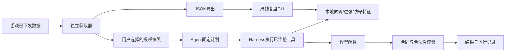

# Majsoul Agent：Agent、harness与获取器

0.4.0整合0.3.0已实现的危险牌、牌效率、综合攻守任务，不重写其本地算法和结构化合同。第一阶段服务于局面分析和复盘。

## 三个边界

| 组件 | 职责 | 实现 |
| --- | --- | --- |
| Collector | 旁路采集、归一化、状态推导、面板、历史与JSON导出 | `protocol.js`、`capture.js`、`state.js`、`history.js`、`overlay.js` |
| Agent | 按任务制定固定工具计划，连接本地证据、模型解释和结果校验 | `extension/agent.js`，复用`analysis.js`与`mahjong-analysis.js` |
| Harness | 工具注册校验、执行预算、取消、超时、运行轨迹；提供离线复盘与回归评测入口 | `extension/harness.js`、`agent/review.cjs`、`agent/eval.cjs` |



当前是有界分析Agent的基础版本：计划固定为快照校验、分析准备、模型解释、结果校验；本地复盘只执行前两步。模型不自行选择工具，不执行任意代码，也没有多轮规划、自我修正或自动打牌。工具边界已经独立，可在后续有明确评测用例时再扩展。

## 执行规则

- 执行前核对完整计划中每个工具是否注册；默认预算6步，最多允许16步。当前在线计划实际为4步。
- 默认25秒，允许的最长预算60秒；取消或超时后不执行后续工具，忽略晚到结果。同步计算不能被JavaScript定时器强制抢占，本地算法自身保留计算边界与缓存。
- `background.js`仍负责扩展身份、主机权限、配置和API密钥。Agent只接收授权快照与注入的模型传输函数，不读取密钥或任意文件。
- 每次执行先复制并清洗输入；本地计算和提示词使用同一份快照。界面继续使用既有指纹标记旧局面结果。
- `majsoul-run-v1`轨迹只记录工具名、状态和相对耗时。不写入牌局原文、模型原文、密钥、请求地址或任意错误文本。成功运行可在面板查看轨迹；失败和取消轨迹由harness附在异常上，当前界面仍显示简短错误。

## 两种安装方式

```sh
npm run build
python scripts/package-public.py
```

前者在`dist/`生成两个加载目录；后者先检查和测试，再生成完整源码、两种安装ZIP和SHA-256文件。获取器只含必要的采集、状态、历史、展示代码与原创牌面。其后台仅处理历史记录，没有模型监听器、模型代码、设置页或可选模型主机权限。

同一页面只启用一个版本，避免重复观察连接。两种扩展存储独立。当前的独立集成方式是JSON导出与离线复盘，尚未提供外部HTTP服务、MCP服务器或跨扩展实时RPC。

## 复盘与评测

```sh
npm run review -- observation.json --seat 0 --hand --cursor 12
npm run review -- observation.json --task danger
npm run eval
```

复盘输入是获取器导出的`mj-observer-v1`对象。牌谱模式只应用游标前的事件，不使用导出对象里的最终状态推测过去；自家手牌默认不参与，需显式`--hand`。实时模式使用导出时的局面，不从可能截断的最近事件列表伪造完整回放。CLI只计算本地结果，不调用模型，输出`majsoul-review-v1`。

`npm run eval`运行3个人工向听样例，通过同一Agent与harness输出`majsoul-eval-v1`报告；失败时进程返回非零。它是执行链与本地结果的回归检查，不是模型牌力评估。真实牌谱集、逐动作标注、模型质量、实战表现与新分发组合的浏览器实测仍待补充。
